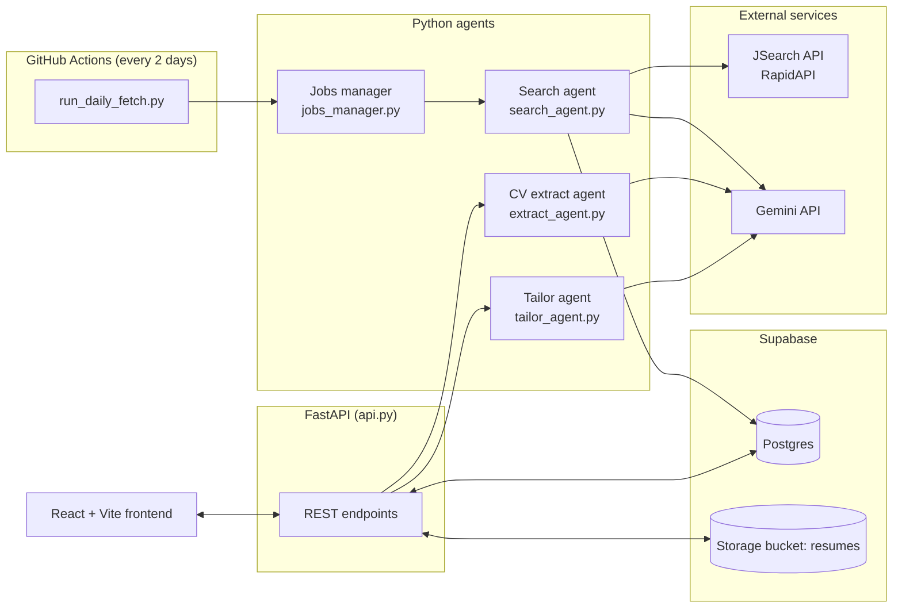
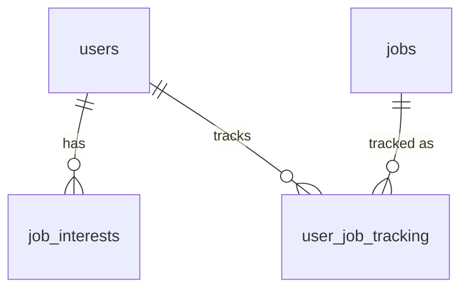

# Job Hunt Pipeline

An agent-based job hunting assistant for internship applications. It searches job boards on a schedule, cleans up the results with an LLM, lets you track applications in a dashboard, and tailors your CV to each job description.

Built as a learning project (React + FastAPI + Supabase) and a portfolio piece.

---

## Table of contents

1. [What it does](#what-it-does)
2. [Project status](#project-status)
3. [Architecture](#architecture)
4. [Tech stack](#tech-stack)
5. [Repository structure](#repository-structure)
6. [The agents](#the-agents)
7. [Database schema](#database-schema)
8. [API reference](#api-reference)
9. [Frontend](#frontend)
10. [Scheduled fetching (GitHub Actions)](#scheduled-fetching-github-actions)
11. [Setup and running locally](#setup-and-running-locally)
12. [Design decisions](#design-decisions)
13. [Known limitations and cleanup list](#known-limitations-and-cleanup-list)
14. [Roadmap](#roadmap)
15. [Development history](#development-history)

---

## What it does

| Goal | How it is done |
| --- | --- |
| Search job platforms by field and location | The **Search agent** queries the JSearch API (via RapidAPI) for each saved interest (role + country/city) and stores the results in Postgres. |
| Make raw postings usable | The **Enrichment step** sends postings to Gemini in batches to extract duration, minimum months, skills and application deadline. |
| Suggest CV tailoring per job | The **Tailor agent** embeds the job description and each CV bullet, scores relevance, and asks Gemini to reword only the relevant entries without inventing facts. |
| Track applications like a spreadsheet | The **Dashboard** shows each tracked job with status, duration, deadline, apply link and your own uploaded CV, plus a deadline calendar. |
| Add jobs that are not in the search results | Add by **pasting a URL** (three-tier extraction) or by **manual entry**. |
| Alerts 1 week and 1 day before a deadline | **Not built yet.** See [Roadmap](#roadmap). |

---

## Project status

| Component | Status |
| --- | --- |
| Search agent (JSearch to Postgres, dedupe by apply link) | Working |
| LLM enrichment (batched, retry up to 5 times) | Working |
| Daily fetch + stale job cleanup + fetch logging | Working, runs from GitHub Actions every 2 days |
| Tailor agent (embeddings + generation) | Working, generates per-entry suggestions |
| CV upload + structured extraction | Working (PDF only, max 10 MB) |
| Tracker (add, status, untrack/retrack, edit, manual entry, add from URL) | Working |
| Per-user edits on shared jobs (`overrides`) | Working |
| Deadline calendar | Working (only for ISO dates) |
| Notifier agent (email/bot alerts) | **Not built** |
| Real authentication | **Not built.** `get_current_user_id()` returns `1` |
| Managing search interests from the UI | **Not built.** Interests are added by running `jobs_manager.py` |
| Deployment | **Not done.** Frontend and backend run locally |

---

## Architecture



Two separate flows share one database:

- **Background flow (no user involved):** the scheduler runs `run_daily_fetch.py`, which finds the distinct active interests, searches JSearch, inserts new jobs, enriches them with Gemini, and deletes stale ones.
- **Interactive flow (user in the browser):** the React app calls FastAPI, which reads and writes Postgres and Storage and calls the extract and tailor agents when needed.

---

## Tech stack

| Layer | Choice |
| --- | --- |
| Frontend | React 18 + Vite 5 (plain CSS) |
| Backend | FastAPI, Uvicorn, Pydantic |
| Database | Supabase Postgres |
| File storage | Supabase Storage (bucket `resumes`) |
| Job data | JSearch via RapidAPI (`search-v2` endpoint) |
| LLM (extraction, rewriting) | Google Gemini (`gemini-3.5-flash-lite`) |
| Embeddings | Gemini (`gemini-embedding-001`), cosine similarity with NumPy |
| DB access | `supabase` client in the API, `psycopg2` in the batch scripts |
| Scraping (add from URL) | `requests` + BeautifulSoup |
| Scheduling | GitHub Actions cron |
| Package management | `uv` (Python), `npm` (frontend) |

---

## Repository structure

```
job-hunt-agent/
├── .github/workflows/daily_fetch.yml   # cron job: runs run_daily_fetch.py
├── src/job_hunt_agent/
│   └── api.py                          # FastAPI app (all endpoints)
├── front-end/
│   ├── src/
│   │   ├── App.jsx                     # top-level state + all fetch calls
│   │   ├── components/
│   │   │   ├── Sidebar.jsx             # navigation
│   │   │   ├── Dashboard.jsx           # tracker table, URL bar, calendar
│   │   │   ├── Explore.jsx             # browse/filter all jobs
│   │   │   ├── CVPage.jsx              # upload master CV, view parsed structure
│   │   │   ├── Drawer.jsx              # per-job panel: tailored bullets, uploads
│   │   │   ├── JobDescription.jsx
│   │   │   ├── JobFormModal.jsx        # manual add / edit job
│   │   │   └── Calendar.jsx            # deadline calendar
│   │   ├── data.js                     # status list + status colour classes
│   │   ├── locationGroup.js            # groups location text by city
│   │   └── index.css
│   ├── package.json
│   └── vite.config.js
├── search_agent.py                     # JSearch search, insert, LLM enrichment
├── jobs_manager.py                     # interests, backfill, daily fetch, cleanup, logging
├── run_daily_fetch.py                  # one-shot entry point for the scheduler
├── extract_agent.py                    # CV PDF -> structured JSON via Gemini
├── tailor_agent.py                     # embeddings + per-entry CV rewriting
├── user_job_tracker.py                 # early standalone tracker helpers (superseded by api.py)
├── debug_query.py / debug_query2.py    # experiments with JSearch query/country parameters
├── pyproject.toml / uv.lock
└── .env                                # secrets (git-ignored)
```

`cv.pdf`, `cv.txt`, `cv_structured.json` and `.env` are git-ignored because they hold personal data and secrets.

---

## The agents

### 1. Search agent (`search_agent.py`)

Pipeline: **search, insert raw rows as `pending`, enrich in batches, update rows.**

- `search_jobs(role, country, city, num_pages, date_posted)` builds the query `"{role} in {city}, {country}"`, converts the country to an ISO code with `pycountry`, and pages through results using the API cursor.
- `insert_jobs()` writes raw rows with `ON CONFLICT (job_apply_link) DO NOTHING`, so the same posting is never stored twice. It returns the number of genuinely new rows.
- `extract_job_info_batch()` sends **10 postings per Gemini call** and asks for a JSON array with `duration`, `min_duration_months`, `skills` and `application_deadline`. Results are matched back by `job_id`.
- `enrich_pending_jobs()` processes rows where `enrichment_status IN ('pending','failed')` and `enrichment_attempts < 5`. A failed batch (bad JSON, API error) marks every row in it as `failed` and increments the attempt counter, so it is retried on the next run. It sleeps 13 seconds between batches to stay under the per-minute rate limit.

> Finding from `debug_query.py`: JSearch returned results for "data scientist intern in Singapore" **only when the `country` parameter was also passed** (`sg`). Without it, or for Thailand queries, results were empty. This is why `get_country_code()` exists.

### 2. Jobs manager (`jobs_manager.py`)

Manages the saved searches (`job_interests`) and runs the daily cycle.

- `add_interest()` normalises role/country/city to lowercase and upserts into `job_interests`. It returns `pair_is_new`, which is `True` unless that exact pair was already backfilled.
- `backfill_new_pair()` runs a deeper first search (5 pages, last month) for a new pair, marks it `backfilled`, then enriches.
- `run_daily_fetch()` takes the **distinct** active `(role, country, city)` pairs across all users (so two users with the same interest cost one API call), fetches 1 page from the last week, inserts, enriches all pending rows once, then runs cleanup.
- `cleanup_stale_jobs()` deletes jobs whose expiration has passed, that were posted more than 3 months ago, or whose LLM-extracted deadline was more than a week ago. The deadline is free text, so it is parsed in Python with `dateutil`; anything unparsable (for example "rolling basis") is left alone rather than guessed.
- `log_fetch()` writes one row to `fetch_logs` per search, enrichment and cleanup step, with counts, duration and any error.

### 3. CV extract agent (`extract_agent.py`)

Sends the PDF bytes to Gemini (temperature 0) and returns the CV as JSON that **keeps the CV's own section names and order**, in this shape:

```json
{
  "sections": [
    {
      "title": "EDUCATION",
      "entries": [
        {
          "heading": "...",
          "subheading": "... or null",
          "dates": "... or null",
          "bullets": ["exact line from the CV"]
        }
      ]
    }
  ]
}
```

The prompt tells the model to copy text exactly and not rewrite anything. The result is stored in `users.cv_structure`.

### 4. Tailor agent (`tailor_agent.py`)

This is the retrieval step of the project. For one job description:

1. Embed the job description once.
2. For each CV entry, embed each bullet and compute **cosine similarity** against the job description.
3. If an entry's best bullet scores below `ENTRY_RELEVANCE_THRESHOLD` (0.45), leave the entry untouched.
4. Otherwise, take the bullets that clear the threshold, pick the **lowest-scoring of those (up to 4)** and ask Gemini to reword them. The reasoning: a bullet that already scores high already reads as relevant, while one that barely passes is relevant in substance but weakly worded for this job.
5. The prompt forbids inventing facts, numbers or experience.

Output is the same sections/entries structure with `tailored_bullets`, `relevance_score` and `status` added per entry. It is saved to `user_job_tracking.tailored_cv`.

The tailor agent works on one entry at a time, so a prompt never mixes bullets from different jobs or projects.

### 5. Tracker (`api.py`, with early version in `user_job_tracker.py`)

The tracker "agent" is now part of the API: adding a job, changing status, untracking and retracking, editing, manual entry and add-from-URL all live in `api.py`. `user_job_tracker.py` is the first standalone version and is no longer used by the app.

---

## Database schema

Hosted on Supabase Postgres. Five tables.



### `users`

| Column | Type | Notes |
| --- | --- | --- |
| `user_id` | integer, PK | auto-increment |
| `name` | text | |
| `email` | text, not null | |
| `resume_path` | text | path in the `resumes` bucket, `{user_id}/cv.pdf` |
| `cv_structure` | jsonb | parsed master CV (see extract agent) |
| `resume_filename` | text | original file name |
| `resume_size_kb` | integer | |
| `resume_updated_at` | timestamptz | |
| `created_at` | timestamptz | default `now()` |

### `jobs` (shared by all users)

| Column | Type | Notes |
| --- | --- | --- |
| `job_id` | text, PK | JSearch id, or `manual-...` for user-added jobs |
| `job_title`, `employer_name`, `job_publisher` | text | publisher is the source (LinkedIn, Indeed, ...), or `Manual` / `Link` |
| `job_employment_type` | text | |
| `job_apply_link` | text | used for dedupe (`ON CONFLICT`) |
| `job_description` | text | |
| `job_is_remote` | boolean | |
| `job_city`, `job_country` | text | |
| `job_posted_at_datetime_utc` | timestamp | |
| `job_offer_expiration_datetime_utc` | timestamp | |
| `job_normalized_title` | text | |
| `duration` | text | LLM-extracted, human readable |
| `min_duration_months` | integer | LLM-extracted |
| `skills` | text[] | LLM-extracted |
| `application_deadline` | text | LLM-extracted, free text |
| `short_description` | text | |
| `enrichment_status` | text | `pending` / `done` / `failed` |
| `enrichment_attempts` | integer | stops retrying at 5 |

### `user_job_tracking` (one row per user and job)

| Column | Type | Notes |
| --- | --- | --- |
| `tracking_id` | integer, PK | |
| `user_id` | integer, FK to `users` | |
| `job_id` | text, FK to `jobs` | |
| `status` | text | default `not_applied` in the schema; the app writes `Saved / Not Applied` |
| `tailored_cv` | text | JSON string from the tailor agent |
| `status_updated_at` | timestamptz | |
| `my_upload_path` | text | the user's own CV for this job, `{user_id}/tailored/{job_id}.{ext}` |
| `overrides` | jsonb | this user's edits to the shared job row (see design decisions) |

Statuses used by the UI: `Saved / Not Applied`, `Submitted`, `Online Assignment`, `Interview Round 1`, `Interview Round 2`, `Offered`, `Rejected`. The internal value `Untracked` hides a job from the dashboard without deleting the row.

### `job_interests` (saved searches)

| Column | Type | Notes |
| --- | --- | --- |
| `interest_id` | integer, PK | |
| `user_id` | integer, FK to `users` | |
| `role`, `country`, `city` | text | stored lowercase; `city` is nullable |
| `status` | text | `active` / `paused` / `removed` |
| `backfilled` | boolean | whether the one-time deep search has run |
| `created_at`, `last_fetched_at` | timestamptz | |

### `fetch_logs`

| Column | Type | Notes |
| --- | --- | --- |
| `log_id` | integer, PK | |
| `run_type` | text | `backfill`, `daily_search`, `enrichment`, `cleanup` |
| `role`, `country`, `city` | text | |
| `num_pages`, `date_posted` | integer, text | search parameters used |
| `num_jobs_found`, `num_jobs_new` | integer | |
| `num_gemini_calls` | integer | |
| `status` | text | default `success` |
| `error_message` | text | |
| `duration_seconds` | numeric | |
| `run_at` | timestamptz | default `now()` |

### Constraints the code depends on

The column listing above does not show unique constraints, but the code relies on these existing:

- `jobs(job_apply_link)` unique, for `ON CONFLICT (job_apply_link)`
- `user_job_tracking(user_id, job_id)` unique
- `job_interests(user_id, role, country, city)` unique, for the interest upsert

### Storage

Bucket `resumes`:

- `{user_id}/cv.pdf`: the master CV (one per user, overwritten on re-upload)
- `{user_id}/tailored/{job_id}.{ext}`: the user's own tailored CV for a specific job

Files are served through signed URLs that expire after 1 hour.

---

## API reference

Base URL: `http://localhost:8000`. All endpoints use `get_current_user_id()` (currently always `1`).

| Method | Path | Purpose |
| --- | --- | --- |
| GET | `/api/health` | Health check |
| GET | `/api/explore-jobs` | Browse all jobs. Query params: `page`, `page_size`, `sort` (`relevance` = newest first, or `deadline`), `role`, `location` (`all`, `singapore`, `bangkok`), `posted_date` (`all`, `today`, `3days`, `week`, `month`). Returns `{jobs, total, page, page_size}` with a `trackState` per job. |
| GET | `/api/tracker` | The user's tracked jobs (excluding `Untracked`), with user edits merged in |
| POST | `/api/tracker` | Add a job by `job_id`. Returns `added`, `retracked` or `already_tracked` |
| PATCH | `/api/tracker/{id}/status` | Change status (`Untracked` removes it from the dashboard) |
| PATCH | `/api/tracker/{id}/edit` | Edit job fields; only the fields that differ are stored in `overrides` |
| POST | `/api/tracker/{id}/generate-bullets` | Run the tailor agent for this job and save the result |
| POST | `/api/tracker/{id}/upload` | Upload your own CV for this job |
| POST | `/api/jobs/manual` | Create a job manually and track it |
| POST | `/api/jobs/from-url` | Create a job from a pasted link (see below) |
| GET | `/api/cv` | Master CV metadata, parsed structure and signed download URL |
| POST | `/api/cv` | Upload master CV (PDF, max 10 MB), store it and extract its structure |

### Add job from URL: three tiers

1. **Structured data:** if the page embeds schema.org `JobPosting` JSON-LD, read company, title, location, deadline (`validThrough`) and description from it.
2. **LLM extraction:** send the page text (max 12,000 characters) to Gemini for duration, skills and any missing fields. Values from JSON-LD win over Gemini's.
3. **Manual fallback:** if the page cannot be read (login wall, JavaScript-only page, no company/title found), the API returns HTTP 422 and the frontend opens the manual form with the link prefilled.

Safety: because the server fetches whatever link it is given, `check_url_is_safe()` rejects non-http(s) links and any address that resolves to a private, loopback, link-local or reserved IP (and re-checks after redirects). Downloads stop after about 2 MB. Pasting the same link twice by the same user gives the same `job_id`, so no duplicate rows are created.

---

## Frontend

React + Vite single-page app with three views, switched by a `view` state in `App.jsx` (no router).

- **Dashboard:** URL bar ("add job from link"), tracker table (status dropdown, duration, deadline, apply link, your upload), add/edit/untrack actions, and a monthly deadline calendar.
- **Explore Jobs:** every job in the database with filters (role, location, posted date), sort (newest or deadline), pagination (20 per page), and an "Add to My Jobs" button that reflects whether you already track it.
- **My CV:** upload the master CV, see file info and the parsed structure, download the file.
- **Drawer (per job):** the job description, tailored bullet suggestions grouped by CV entry, and upload/download of your own CV for that job.

State and all `fetch` calls live in `App.jsx`; components receive data and handlers as props.

---

## Scheduled fetching (GitHub Actions)

`.github/workflows/daily_fetch.yml` runs `uv run python run_daily_fetch.py` on cron `0 4 */2 * *` (04:00 UTC, every second day of the month) and can be triggered manually with `workflow_dispatch`.

Required repository secrets: `DATABASE_URL`, `RAPIDAPI_KEY`, `GEMINI_API_KEY`.

`run_daily_fetch.py` exits with a non-zero code on failure so GitHub marks the run as failed.

---

## Setup and running locally

### Prerequisites

- Python (via [`uv`](https://docs.astral.sh/uv/)) and Node.js
- A Supabase project with the five tables above and a Storage bucket named `resumes`
- A RapidAPI key subscribed to **JSearch**
- A Google Gemini API key

### 1. Environment variables

Create `.env` in the repo root:

```
SUPABASE_URL=https://xxxx.supabase.co
SUPABASE_SERVICE_KEY=...        # service_role key: backend only, never expose
DATABASE_URL=postgresql://...   # Postgres connection string (used by the batch scripts)
RAPIDAPI_KEY=...
GEMINI_API_KEY=...
```

### 2. Backend

```powershell
uv sync
uv run uvicorn job_hunt_agent.api:app --reload --port 8000
```

Run it from the repo root: `api.py` imports `extract_agent` and `tailor_agent`, which sit in the root folder.

### 3. Frontend

```powershell
cd front-end
npm install
npm run dev
```

Opens on `http://localhost:5173` (or 5174). Both ports are allowed by CORS. The frontend calls the backend at the hard-coded `http://localhost:8000`, so both servers must be running.

### 4. Add a search interest and fetch jobs

Edit the `ROLE` / `COUNTRY` / `CITY` values at the bottom of `jobs_manager.py`, then:

```powershell
uv run python jobs_manager.py      # adds the interest and runs the deep backfill
uv run python run_daily_fetch.py   # one daily cycle (what the cron job runs)
```

### 5. Use it

1. Open **My CV** and upload your PDF. Wait for the structure to appear.
2. Open **Explore Jobs** and add jobs to your tracker, or paste a link on the Dashboard.
3. Open a tracked job and press the tailor button to get bullet suggestions.

---

## Design decisions

- **Shared `jobs` table, per-user `user_job_tracking`.** A job is fetched and enriched once, however many users track it. Search cost scales with distinct interests, not with users.
- **`overrides` instead of editing the shared row.** When a user edits a job, only the changed fields go into `user_job_tracking.overrides` and are merged over the shared row when reading. One user's edits never change what other users see.
- **Enrichment is separate from search and idempotent.** Rows are inserted as `pending`, then enriched in batches of 10 with an attempt counter, so a failed LLM call never loses a job and never retries forever.
- **LLM output is treated as untrusted.** The deadline field is free text, so cleanup parses it defensively and leaves anything ambiguous alone.
- **Multi-user ready from the start.** Every endpoint already takes a `user_id`. Adding real auth later means changing only `get_current_user_id()`.
- **CV structure is not a fixed template.** The extractor keeps whatever sections the CV has, and the tailor agent walks them generically.
- **No fabrication.** The tailoring prompt forbids new facts or numbers; the extractor copies text verbatim.
- **No LinkedIn scraping.** Job data comes from the JSearch API, which avoids breaking LinkedIn's terms of service and avoids constant breakage.

---

## Known limitations and cleanup list

Honest list of things that are rough or not finished:

1. **No notifier yet.** The 1-week and 1-day deadline alerts from the original plan are not implemented.
2. **No auth.** The user is hard-coded to `1`, and the sidebar still shows placeholder user details. Some endpoints (`PATCH /status`, `POST /upload`) look up a `tracking_id` without checking it belongs to the current user. That must be fixed before more than one real user exists.
3. **Interests are not manageable from the UI.** They are added by running `jobs_manager.py`.
4. **Explore filters run in Python.** `GET /api/explore-jobs` loads every job and filters, sorts and paginates in memory. Fine for a few thousand rows; move it into SQL (or Supabase query filters) as the table grows. Location filters only know Singapore and Bangkok.
5. **Duplicate route in `api.py`.** `AddTrackerBody` and `POST /api/tracker` are defined twice; the second version (using `track_job_for_user`) is the cleaner one, so delete the first.
6. **Free-text deadlines.** `application_deadline` is `text`. The calendar and the edit form only handle ISO `YYYY-MM-DD` dates, and "ASAP" is shown when nothing is known. Converting it to a `date` column (with a separate raw-text column) would also make the future notifier much simpler.
7. **Status default mismatch.** The column default is `not_applied`, but the app writes `Saved / Not Applied`. Align one with the other.
8. **Python version mismatch.** `pyproject.toml` requires Python `>=3.14`, while the GitHub workflow installs 3.12. Align them.
9. **Per-bullet embedding calls.** The tailor agent embeds each bullet separately on every run, so it makes many API calls and can hit rate limits (the API returns a 502 with a retry message). Caching CV bullet embeddings per user would remove most of them.
10. **No vector database.** Similarity is computed in memory with NumPy, which is enough for one CV. A vector store only becomes worthwhile with much larger corpora.
11. **Leftover files.** `user_job_tracker.py`, `debug_query*.py` and the mock `initialJobs` in `front-end/src/data.js` are no longer needed by the app.
12. **Hard-coded API URL** (`http://localhost:8000`) in several frontend files. Move it to a Vite env variable (`VITE_API_URL`) before deploying.
13. **No tests.**

---

## Roadmap

1. **Notifier agent:** daily scheduled job that finds tracked jobs with deadlines in 7 days and 1 day (and status still before `Submitted`), then sends an email (Resend or SendGrid). Needs a real `date` deadline column and a "last alert sent" marker to avoid repeats.
2. **Interests UI:** add, pause and remove search interests from the app, triggering backfill for new pairs.
3. **Authentication:** Supabase Auth, then replace `get_current_user_id()` and add ownership checks to every endpoint.
4. **Ranking and recommendations:** score jobs against the CV so Explore can sort by "best match" instead of newest.
5. **Better tailoring output:** export the tailored CV as a document, not just suggested bullets.
6. **Deployment:** containerise the backend and host it (Railway or Fly.io) with the frontend on a static host, so there is a live demo link.
7. **Tests and CI:** unit tests for parsing and cleanup logic, and a lint/test workflow.

---

## Development history

The project grew in stages. Each stage is a working step that the next one built on.

1. **Planning.** The original idea was a four-agent system (Search, CV Tailor, Tracker, Notifier) using Claude, LangGraph, Chroma, Postgres, FastAPI and Next.js. While building, the stack was simplified to fit a solo project and free tiers: Gemini for the LLM and embeddings, in-memory cosine similarity instead of a vector DB, Supabase for Postgres and storage, React + Vite for the UI, and GitHub Actions instead of a scheduler service.
2. **Job search and storage.** Built the JSearch search function and Postgres storage. Debugged the API's behaviour (the `country` parameter was required for results), added dedupe on apply link.
3. **LLM enrichment.** Added Gemini extraction of duration, skills and deadline, first per job, then batched 10 per call with status and retry tracking to respect rate limits.
4. **CV pipeline.** Added CV upload to Supabase Storage, structured extraction to JSON, and the tailor agent with embeddings, relevance thresholds and per-entry rewriting.
5. **Tracker and interests.** Added the `user_job_tracking` table, the `job_interests` model with backfill, the daily fetch cycle, stale-job cleanup and `fetch_logs`.
6. **Scheduling.** Added `run_daily_fetch.py` and the GitHub Actions workflow.
7. **Frontend.** Converted a static prototype into a React + Vite app with Dashboard, Explore, My CV, drawer and calendar.
8. **FastAPI server.** Connected Explore Jobs to Supabase, then added filtering, sorting and pagination.
9. **Dashboard wiring.** Wired the Dashboard to `user_job_tracking` with status changes, per-job CV upload and bullet generation.
10. **Tracker polish.** Added untrack/retrack, manual job entry, per-user edit overrides, and the My CV page for the master CV.
11. **Add from URL.** Added three-tier link import (JSON-LD, Gemini, manual fallback) with SSRF protection.