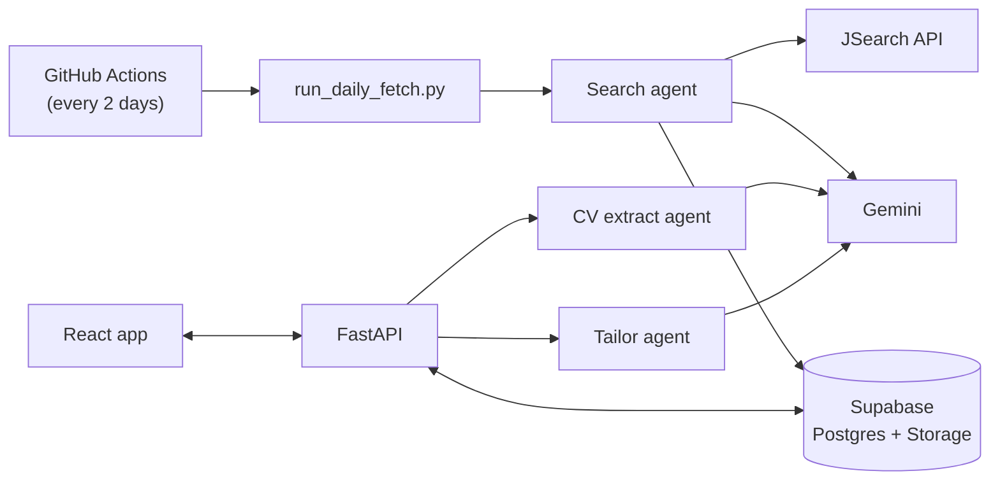

# Job Hunt Pipeline

An agent-based assistant for internship hunting. It searches job boards on a schedule, enriches postings with an LLM, tracks your applications in a dashboard, and suggests CV bullet rewrites tailored to each job.

Built with React, FastAPI, Supabase and Gemini as a learning and portfolio project.

## Features

- **Automatic job search:** saved search interests (role + country/city) are fetched from JSearch every two days.
- **LLM enrichment:** Gemini extracts duration, skills and application deadline from each posting.
- **Application tracker:** status, deadlines, apply links, your own CV per job, and a deadline calendar.
- **Add any job:** paste a posting URL (structured data → LLM → manual form fallback) or enter it by hand.
- **CV tailoring:** upload your CV once; for each job, the most relevant bullets are rewritten to match the description without inventing facts.
- **Works on phone and tablet:** responsive layout for iPhone and iPad, installable to the Home Screen.

## Tech stack

| Layer | Tools |
| --- | --- |
| Frontend | React 18, Vite, plain CSS, pdf.js |
| Backend | FastAPI, Uvicorn, Pydantic |
| Data | Supabase (Postgres + Storage) |
| AI | Gemini (`gemini-3.5-flash-lite`, `gemini-embedding-001`) |
| Job data | JSearch API via RapidAPI |
| Infra | Docker, Render, GitHub Actions, `uv` |

## Architecture



- **Background flow:** a scheduled job searches for every active interest, stores new postings, enriches them, and removes stale ones.
- **Interactive flow:** the React app talks to FastAPI, which reads and writes Supabase and calls the agents when needed.

### The agents

| Agent | File | What it does |
| --- | --- | --- |
| Search | `search_agent.py` | Queries JSearch, de-duplicates by apply link, enriches postings with Gemini in batches of 10 with retries |
| Jobs manager | `jobs_manager.py` | Manages search interests, runs the daily fetch, cleans up expired jobs, logs every run |
| CV extract | `extract_agent.py` | Turns the uploaded PDF into structured JSON (sections → entries → bullets), copying text verbatim |
| Tailor | `tailor_agent.py` | Scores each CV bullet against the job with embeddings and cosine similarity, then rewrites the relevant ones per entry |

## Project structure

```
job-hunt-agent/
├── src/job_hunt_agent/api.py   # FastAPI app (all endpoints)
├── front-end/                  # React + Vite app
├── search_agent.py             # job search + LLM enrichment
├── jobs_manager.py             # interests, daily fetch, cleanup
├── extract_agent.py            # CV PDF → structured JSON
├── tailor_agent.py             # CV tailoring
├── run_daily_fetch.py          # entry point for the scheduled fetch
├── tests/                      # pytest unit tests
├── migrations/                 # one-off SQL for Supabase
├── Dockerfile                  # production image (frontend build + API)
└── render.yaml                 # Render deployment config
```

## Getting started

### Prerequisites

- Python 3.14 with [`uv`](https://docs.astral.sh/uv/), and Node.js
- A Supabase project with the tables `users`, `jobs`, `user_job_tracking`, `job_interests`, `fetch_logs`, and a Storage bucket named `resumes`
- A RapidAPI key subscribed to JSearch, and a Gemini API key

### 1. Configure

Create `.env` in the repo root:

```
SUPABASE_URL=https://xxxx.supabase.co
SUPABASE_SERVICE_KEY=...        # service_role key, backend only
DATABASE_URL=postgresql://...   # use the Supabase pooler URL
RAPIDAPI_KEY=...
GEMINI_API_KEY=...
APP_ACCESS_KEY=                 # optional locally; required when deployed
```

### 2. Run

```bash
# backend (from the repo root)
uv sync
uv run uvicorn job_hunt_agent.api:app --reload --port 8000

# frontend (second terminal)
cd front-end
npm install
npm run dev
```

Open http://localhost:5173. Vite proxies `/api` to the backend.

To use it from a phone or tablet on the same Wi-Fi, open the `Network:` address Vite prints.

### 3. Use it

1. **My CV:** upload your CV as a PDF.
2. **Explore Jobs → Search interests:** add a role and country. The first search runs in the background.
3. Add jobs to your tracker from Explore, or paste a job link on the Dashboard.
4. Open a tracked job and click **Generate** for tailored bullet suggestions.

## Deployment

The app deploys to [Render](https://render.com) as a single Docker service. The image builds the React app, and FastAPI serves both the page and `/api`.

1. Push the repo to GitHub.
2. In Render: **New → Blueprint**, then select the repo (it reads `render.yaml`).
3. Enter the secrets from your `.env`, plus a long random `APP_ACCESS_KEY`.
4. Open the `onrender.com` URL and enter the access key once per device.

Every push to `main` redeploys. On the free plan the service sleeps after 15 minutes without traffic, so the first request after a break takes 30–60 seconds.

**Keeping it awake:** a free [UptimeRobot](https://uptimerobot.com) HTTP monitor on `https://<your-app>.onrender.com/api/health` every 5 minutes keeps the service from sleeping. The health check needs no access key. An always-on service uses about 744 of Render's 750 free hours a month, so this only works for one free service per workspace.

**Access key:** the app is single-user. When `APP_ACCESS_KEY` is set, every API request must send it in the `X-Access-Key` header. The frontend asks for it once and remembers it in that browser.

**Scheduled fetch:** `.github/workflows/daily_fetch.yml` runs `run_daily_fetch.py` every two days. It needs the repository secrets `DATABASE_URL`, `RAPIDAPI_KEY` and `GEMINI_API_KEY`.

## Testing

```bash
uv run pytest -q
```

Tests use dummy keys and never call external services. They also run on every push via GitHub Actions.

## API overview

| Area | Endpoints |
| --- | --- |
| Jobs | `GET /api/explore-jobs`, `GET /api/explore-locations`, `POST /api/jobs/manual`, `POST /api/jobs/from-url` |
| Tracker | `GET/POST /api/tracker`, `PATCH /api/tracker/{id}/status`, `PATCH /api/tracker/{id}/edit`, `POST /api/tracker/{id}/upload`, `POST /api/tracker/{id}/generate-bullets` |
| CV | `GET/POST /api/cv`, `GET /api/cv/file` |
| Interests | `GET/POST /api/interests`, `PATCH/DELETE /api/interests/{id}` |
| Other | `GET /api/health`, `GET /api/me` |

FastAPI also serves interactive docs at `/docs` when running locally.

## Limitations

- Single user with a shared access key; there are no user accounts yet.
- Application deadlines are stored as free text, so only ISO dates show on the calendar.
- No deadline notifications yet.

## Roadmap

- Email alerts 1 week and 1 day before deadlines
- Store deadlines as real dates
- Rank Explore results by match with your CV
- Export the tailored CV as a document
- User accounts with Supabase Auth
