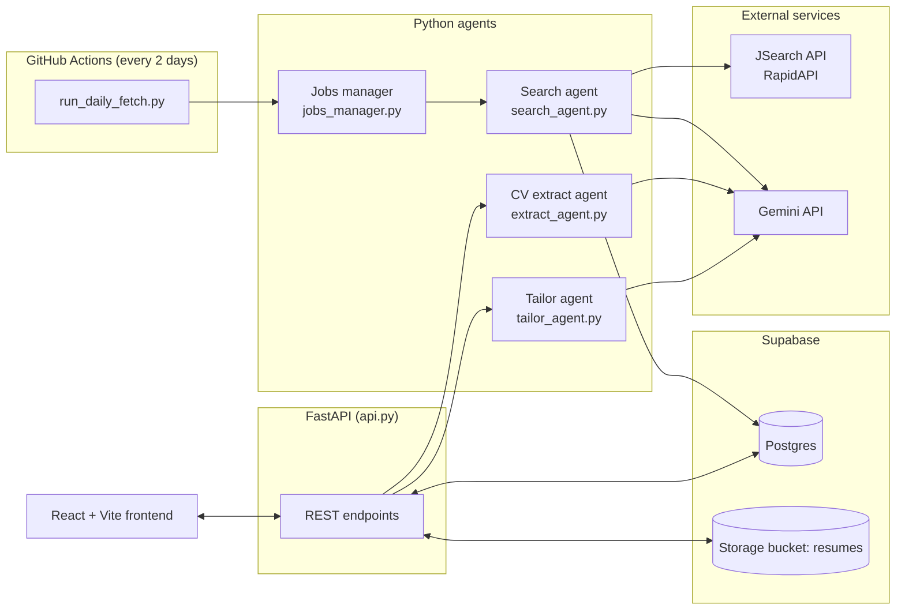
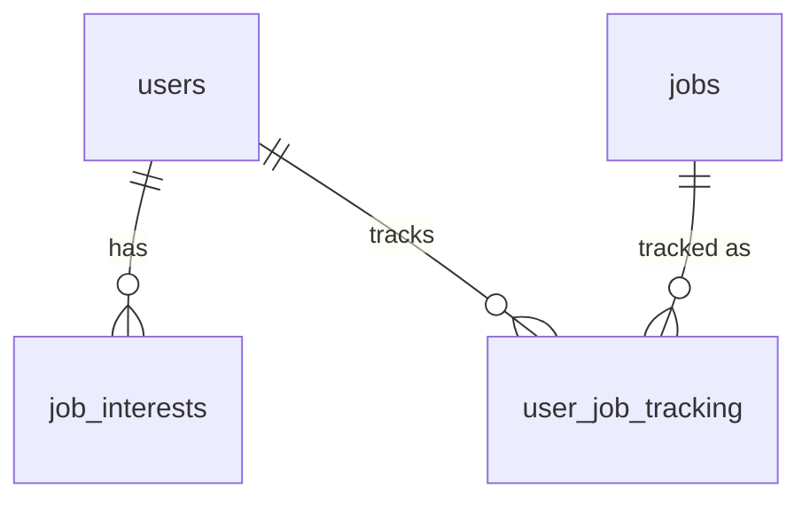

# Job Hunt Pipeline

An agent-based job hunting assistant for internship applications. It searches job boards on a schedule, cleans up the results with an LLM, lets you track applications in a dashboard, and tailors your CV to each job description.

Built as a learning project (React + FastAPI + Supabase) and a portfolio piece.

---

## Table of contents

1. [What it does](#what-it-does)
2. [Project status](#project-status)
3. [Architecture](#architecture)
4. [Tech stack](#tech-stack)
5. [Repository structure](#repository-structure)
6. [The agents](#the-agents)
7. [Database schema](#database-schema)
8. [API reference](#api-reference)
9. [Frontend](#frontend)
10. [Scheduled fetching (GitHub Actions)](#scheduled-fetching-github-actions)
11. [Setup and running locally](#setup-and-running-locally)
12. [Deployment (Render)](#deployment-render)
13. [Design decisions](#design-decisions)
14. [Known limitations and cleanup list](#known-limitations-and-cleanup-list)
15. [Roadmap](#roadmap)
16. [Development history](#development-history)

---

## What it does

| Goal | How it is done |
| --- | --- |
| Search job platforms by field and location | The **Search agent** queries the JSearch API (via RapidAPI) for each saved interest (role + country/city) and stores the results in Postgres. |
| Make raw postings usable | The **Enrichment step** sends postings to Gemini in batches to extract duration, minimum months, skills and application deadline. |
| Suggest CV tailoring per job | The **Tailor agent** embeds the job description and each CV bullet, scores relevance, and asks Gemini to reword only the relevant entries without inventing facts. |
| Track applications like a spreadsheet | The **Dashboard** shows each tracked job with status, duration, deadline, apply link and your own uploaded CV, plus a deadline calendar. |
| Add jobs that are not in the search results | Add by **pasting a URL** (three-tier extraction) or by **manual entry**. |
| Alerts 1 week and 1 day before a deadline | **Not built yet.** See [Roadmap](#roadmap). |

---

## Project status

| Component | Status |
| --- | --- |
| Search agent (JSearch to Postgres, dedupe by apply link) | Working |
| LLM enrichment (batched, retry up to 5 times) | Working |
| Daily fetch + stale job cleanup + fetch logging | Working, runs from GitHub Actions every 2 days |
| Tailor agent (embeddings + generation) | Working, generates per-entry suggestions; bullet embeddings are batched and cached |
| CV upload + structured extraction | Working (PDF only, max 10 MB); My CV shows the real PDF |
| Tracker (add, status, untrack/retrack, edit, manual entry, add from URL) | Working |
| Per-user edits on shared jobs (`overrides`) | Working |
| Deadline calendar | Working (only for ISO dates) |
| Notifier agent (email/bot alerts) | **Not built** |
| Real authentication | **Not built on purpose (single user for now).** `get_current_user_id()` returns `1`; every endpoint checks rows belong to that user |
| Managing search interests from the UI | Working (Explore → Search interests): add, pause, resume, remove, retry a failed first fetch |
| Phone and tablet layout | Working: icon rail on iPad, bottom tab bar and card rows on iPhone |
| Tests | `pytest` unit tests for parsing, cleanup, URL safety and tailoring helpers, run in CI |
| Deployment | One Docker service on Render (FastAPI serves the React build), locked with an access key. See [Deployment](#deployment-render) |

---

## Architecture



Two separate flows share one database:

- **Background flow (no user involved):** the scheduler runs `run_daily_fetch.py`, which finds the distinct active interests, searches JSearch, inserts new jobs, enriches them with Gemini, and deletes stale ones.
- **Interactive flow (user in the browser):** the React app calls FastAPI, which reads and writes Postgres and Storage and calls the extract and tailor agents when needed.

---

## Tech stack

| Layer | Choice |
| --- | --- |
| Frontend | React 18 + Vite 5 (plain CSS), pdf.js for the CV preview |
| Backend | FastAPI, Uvicorn, Pydantic |
| Database | Supabase Postgres |
| File storage | Supabase Storage (bucket `resumes`) |
| Job data | JSearch via RapidAPI (`search-v2` endpoint) |
| LLM (extraction, rewriting) | Google Gemini (`gemini-3.5-flash-lite`) |
| Embeddings | Gemini (`gemini-embedding-001`), cosine similarity with NumPy |
| DB access | `supabase` client in the API, `psycopg2` in the batch scripts |
| Scraping (add from URL) | `requests` + BeautifulSoup |
| Scheduling | GitHub Actions cron |
| Package management | `uv` (Python), `npm` (frontend) |

---

## Repository structure

```
job-hunt-agent/
├── .github/workflows/daily_fetch.yml   # cron job: runs run_daily_fetch.py
├── .github/workflows/tests.yml         # runs pytest on every push
├── src/job_hunt_agent/
│   └── api.py                          # FastAPI app (all endpoints)
├── front-end/
│   ├── src/
│   │   ├── App.jsx                     # top-level state + most fetch calls
│   │   ├── api.js                      # backend base URL (VITE_API_URL, default: same origin)
│   │   ├── components/
│   │   │   ├── Sidebar.jsx             # navigation
│   │   │   ├── Dashboard.jsx           # tracker table, URL bar, calendar
│   │   │   ├── Explore.jsx             # browse/filter all jobs
│   │   │   ├── CVPage.jsx              # upload master CV, preview the PDF, view parsed text
│   │   │   ├── PdfViewer.jsx           # renders every PDF page to a canvas with pdf.js
│   │   │   ├── InterestsModal.jsx      # manage search interests
│   │   │   ├── Drawer.jsx              # per-job panel: tailored bullets, uploads
│   │   │   ├── JobDescription.jsx
│   │   │   ├── JobFormModal.jsx        # manual add / edit job
│   │   │   └── Calendar.jsx            # deadline calendar
│   │   ├── data.js                     # status list + status colour classes
│   │   ├── locationGroup.js            # groups location text by city
│   │   └── index.css
│   ├── package.json
│   └── vite.config.js
├── search_agent.py                     # JSearch search, insert, LLM enrichment
├── jobs_manager.py                     # interests, backfill, daily fetch, cleanup, logging
├── run_daily_fetch.py                  # one-shot entry point for the scheduler
├── extract_agent.py                    # CV PDF -> structured JSON via Gemini
├── tailor_agent.py                     # embeddings + per-entry CV rewriting
├── migrations/                         # one-off SQL to run in the Supabase SQL editor
├── tests/                              # pytest unit tests
├── pyproject.toml / uv.lock
└── .env                                # secrets (git-ignored)
```

`cv.pdf`, `cv.txt`, `cv_structured.json` and `.env` are git-ignored because they hold personal data and secrets.

---

## The agents

### 1. Search agent (`search_agent.py`)

Pipeline: **search, insert raw rows as `pending`, enrich in batches, update rows.**

- `search_jobs(role, country, city, num_pages, date_posted)` builds the query `"{role} in {city}, {country}"`, converts the country to an ISO code with `pycountry`, and pages through results using the API cursor.
- `insert_jobs()` writes raw rows with `ON CONFLICT (job_apply_link) DO NOTHING`, so the same posting is never stored twice. It returns the number of genuinely new rows.
- `extract_job_info_batch()` sends **10 postings per Gemini call** and asks for a JSON array with `duration`, `min_duration_months`, `skills` and `application_deadline`. Results are matched back by `job_id`.
- `enrich_pending_jobs()` processes rows where `enrichment_status IN ('pending','failed')` and `enrichment_attempts < 5`. A failed batch (bad JSON, API error) marks every row in it as `failed` and increments the attempt counter, so it is retried on the next run. It sleeps 13 seconds between batches to stay under the per-minute rate limit.

> Finding from `debug_query.py`: JSearch returned results for "data scientist intern in Singapore" **only when the `country` parameter was also passed** (`sg`). Without it, or for Thailand queries, results were empty. This is why `get_country_code()` exists.

### 2. Jobs manager (`jobs_manager.py`)

Manages the saved searches (`job_interests`) and runs the daily cycle.

- `add_interest()` normalises role/country/city to lowercase and upserts into `job_interests`. It returns `pair_is_new`, which is `True` unless that exact pair was already backfilled.
- `backfill_new_pair()` runs a deeper first search (5 pages, last month) for a new pair, marks it `backfilled`, then enriches.
- `run_daily_fetch()` takes the **distinct** active `(role, country, city)` pairs across all users (so two users with the same interest cost one API call), fetches 1 page from the last week, inserts, enriches all pending rows once, then runs cleanup.
- `cleanup_stale_jobs()` deletes jobs whose expiration has passed, that were posted more than 3 months ago, or whose LLM-extracted deadline was more than a week ago. The deadline is free text, so it is parsed in Python with `dateutil`; anything unparsable (for example "rolling basis") is left alone rather than guessed.
- `log_fetch()` writes one row to `fetch_logs` per search, enrichment and cleanup step, with counts, duration and any error.

### 3. CV extract agent (`extract_agent.py`)

Sends the PDF bytes to Gemini (temperature 0) and returns the CV as JSON that **keeps the CV's own section names and order**, in this shape:

```json
{
  "sections": [
    {
      "title": "EDUCATION",
      "entries": [
        {
          "heading": "...",
          "subheading": "... or null",
          "dates": "... or null",
          "bullets": ["exact line from the CV"]
        }
      ]
    }
  ]
}
```

The prompt tells the model to copy text exactly and not rewrite anything. The result is stored in `users.cv_structure`.

### 4. Tailor agent (`tailor_agent.py`)

This is the retrieval step of the project. For one job description:

1. Embed the job description once.
2. Embed every CV bullet in batched calls (up to 100 per request) and keep the vectors in an in-process cache, so after the first run only the job description needs a new embedding. Then score each bullet with **cosine similarity** against the job description.
3. If an entry's best bullet scores below `ENTRY_RELEVANCE_THRESHOLD` (0.45), leave the entry untouched.
4. Otherwise, take the bullets that clear the threshold, pick the **lowest-scoring of those (up to 4)** and ask Gemini to reword them. The reasoning: a bullet that already scores high already reads as relevant, while one that barely passes is relevant in substance but weakly worded for this job.
5. The prompt forbids inventing facts, numbers or experience.

Output is the same sections/entries structure with `tailored_bullets`, `relevance_score` and `status` added per entry. It is saved to `user_job_tracking.tailored_cv`.

The tailor agent works on one entry at a time, so a prompt never mixes bullets from different jobs or projects.

### 5. Tracker (`api.py`)

The tracker "agent" is part of the API: adding a job, changing status, untracking and retracking, editing, manual entry and add-from-URL all live in `api.py`.

---

## Database schema

Hosted on Supabase Postgres. Five tables.



### `users`

| Column | Type | Notes |
| --- | --- | --- |
| `user_id` | integer, PK | auto-increment |
| `name` | text | |
| `email` | text, not null | |
| `resume_path` | text | path in the `resumes` bucket, `{user_id}/cv.pdf` |
| `cv_structure` | jsonb | parsed master CV (see extract agent) |
| `resume_filename` | text | original file name |
| `resume_size_kb` | integer | |
| `resume_updated_at` | timestamptz | |
| `created_at` | timestamptz | default `now()` |

### `jobs` (shared by all users)

| Column | Type | Notes |
| --- | --- | --- |
| `job_id` | text, PK | JSearch id, or `manual-...` for user-added jobs |
| `job_title`, `employer_name`, `job_publisher` | text | publisher is the source (LinkedIn, Indeed, ...), or `Manual` / `Link` |
| `job_employment_type` | text | |
| `job_apply_link` | text | used for dedupe (`ON CONFLICT`) |
| `job_description` | text | |
| `job_is_remote` | boolean | |
| `job_city`, `job_country` | text | |
| `job_posted_at_datetime_utc` | timestamp | |
| `job_offer_expiration_datetime_utc` | timestamp | |
| `job_normalized_title` | text | |
| `duration` | text | LLM-extracted, human readable |
| `min_duration_months` | integer | LLM-extracted |
| `skills` | text[] | LLM-extracted |
| `application_deadline` | text | LLM-extracted, free text |
| `short_description` | text | |
| `enrichment_status` | text | `pending` / `done` / `failed` |
| `enrichment_attempts` | integer | stops retrying at 5 |

### `user_job_tracking` (one row per user and job)

| Column | Type | Notes |
| --- | --- | --- |
| `tracking_id` | integer, PK | |
| `user_id` | integer, FK to `users` | |
| `job_id` | text, FK to `jobs` | |
| `status` | text | default `not_applied` in the schema; the app writes `Saved / Not Applied` |
| `tailored_cv` | text | JSON string from the tailor agent |
| `status_updated_at` | timestamptz | |
| `my_upload_path` | text | the user's own CV for this job, `{user_id}/tailored/{job_id}.{ext}` |
| `overrides` | jsonb | this user's edits to the shared job row (see design decisions) |

Statuses used by the UI: `Saved / Not Applied`, `Submitted`, `Online Assignment`, `Interview Round 1`, `Interview Round 2`, `Offered`, `Rejected`. The internal value `Untracked` hides a job from the dashboard without deleting the row.

### `job_interests` (saved searches)

| Column | Type | Notes |
| --- | --- | --- |
| `interest_id` | integer, PK | |
| `user_id` | integer, FK to `users` | |
| `role`, `country`, `city` | text | stored lowercase; `city` is nullable |
| `status` | text | `active` / `paused` / `removed` |
| `backfilled` | boolean | whether the one-time deep search has run |
| `created_at`, `last_fetched_at` | timestamptz | |

### `fetch_logs`

| Column | Type | Notes |
| --- | --- | --- |
| `log_id` | integer, PK | |
| `run_type` | text | `backfill`, `daily_search`, `enrichment`, `cleanup` |
| `role`, `country`, `city` | text | |
| `num_pages`, `date_posted` | integer, text | search parameters used |
| `num_jobs_found`, `num_jobs_new` | integer | |
| `num_gemini_calls` | integer | |
| `status` | text | default `success` |
| `error_message` | text | |
| `duration_seconds` | numeric | |
| `run_at` | timestamptz | default `now()` |

### Constraints the code depends on

The column listing above does not show unique constraints, but the code relies on these existing:

- `jobs(job_apply_link)` unique, for `ON CONFLICT (job_apply_link)`
- `user_job_tracking(user_id, job_id)` unique
- `job_interests(user_id, role, country, city)` unique, for the interest upsert

### Storage

Bucket `resumes`:

- `{user_id}/cv.pdf`: the master CV (one per user, overwritten on re-upload)
- `{user_id}/tailored/{job_id}.{ext}`: the user's own tailored CV for a specific job

Files are served through signed URLs that expire after 1 hour.

---

## API reference

Base URL: `http://localhost:8000` (the Vite dev server proxies `/api` to it). All endpoints use `get_current_user_id()` (currently always `1`), and every endpoint that takes a `tracking_id` or `interest_id` only touches rows that belong to that user.

| Method | Path | Purpose |
| --- | --- | --- |
| GET | `/api/health` | Health check |
| GET | `/api/me` | Name and email of the current user (shown in the sidebar) |
| GET | `/api/explore-jobs` | Browse all jobs. Query params: `page`, `page_size` (max 100), `sort` (`relevance` = newest first, or `deadline`), `role` (title contains), `location` (any city or country name, or `all`), `posted_date` (`all`, `today`, `3days`, `week`, `month`). Filtering, sorting and paging run in Postgres. Returns `{jobs, total, page, page_size}` with a `trackState` per job. |
| GET | `/api/explore-locations` | Location filter options: the city (or country) of each of your search interests |
| GET | `/api/tracker` | The user's tracked jobs (excluding `Untracked`), with user edits merged in |
| POST | `/api/tracker` | Add a job by `job_id`. Returns `added`, `retracked` or `already_tracked` |
| PATCH | `/api/tracker/{id}/status` | Change status (`Untracked` removes it from the dashboard) |
| PATCH | `/api/tracker/{id}/edit` | Edit job fields; only the fields that differ are stored in `overrides` |
| POST | `/api/tracker/{id}/generate-bullets` | Run the tailor agent for this job and save the result |
| POST | `/api/tracker/{id}/upload` | Upload your own CV for this job |
| POST | `/api/jobs/manual` | Create a job manually and track it |
| POST | `/api/jobs/from-url` | Create a job from a pasted link (see below) |
| GET | `/api/cv` | Master CV metadata, parsed structure and signed download URL |
| GET | `/api/cv/file` | The master CV PDF itself, served by the API so the preview has no CORS or expiry issues |
| POST | `/api/cv` | Upload master CV (PDF, max 10 MB), store it and extract its structure |
| GET | `/api/interests` | Your search interests with `fetchState`: `done`, `running`, `failed` or `pending` |
| POST | `/api/interests` | Add an interest; a new pair starts the deep backfill in the background |
| PATCH | `/api/interests/{id}` | Pause or resume. Resuming an interest whose first fetch never finished (or failed) starts it again |
| DELETE | `/api/interests/{id}` | Remove an interest (jobs already found stay) |

### Add job from URL: three tiers

1. **Structured data:** if the page embeds schema.org `JobPosting` JSON-LD, read company, title, location, deadline (`validThrough`) and description from it.
2. **LLM extraction:** send the page text (max 12,000 characters) to Gemini for duration, skills and any missing fields. Values from JSON-LD win over Gemini's.
3. **Manual fallback:** if the page cannot be read (login wall, JavaScript-only page, no company/title found), the API returns HTTP 422 and the frontend opens the manual form with the link prefilled.

Safety: because the server fetches whatever link it is given, `check_url_is_safe()` rejects non-http(s) links and any address that resolves to a private, loopback, link-local or reserved IP (and re-checks after redirects). Downloads stop after about 2 MB. Pasting the same link twice by the same user gives the same `job_id`, so no duplicate rows are created.

---

## Frontend

React + Vite single-page app with three views, switched by a `view` state in `App.jsx` (no router).

- **Dashboard:** URL bar ("add job from link"), tracker table (status dropdown, duration, deadline, apply link, your upload), add/edit/untrack actions, and a monthly deadline calendar.
- **Explore Jobs:** every job in the database with filters (role, location from your interests, posted date), sort (newest or deadline), pagination (20 per page), an "Add to My Jobs" button that reflects whether you already track it, and the **Search interests** manager.
- **My CV:** upload the master CV, see the actual PDF (every page, rendered with pdf.js so it also scrolls on iPhone/iPad), download it, and expand "Text read from your CV" to check what the tailor agent works from.
- **Drawer (per job):** the job description, tailored bullet suggestions grouped by CV entry, and upload/download of your own CV for that job.

State and most `fetch` calls live in `App.jsx`; components receive data and handlers as props. The backend base URL comes from `src/api.js`.

**Phone and tablet:** at iPad widths (761–1100 px) the sidebar becomes an icon rail; on phones (760 px and below) it becomes a bottom tab bar, table rows turn into cards, and modals open as bottom sheets. Inputs use 16 px text on touch devices so iOS does not zoom in, and safe-area insets are respected when the app is added to the Home Screen.

---

## Scheduled fetching (GitHub Actions)

`.github/workflows/daily_fetch.yml` runs `uv run python run_daily_fetch.py` on cron `0 4 */2 * *` (04:00 UTC, every second day of the month) and can be triggered manually with `workflow_dispatch`.

Required repository secrets: `DATABASE_URL`, `RAPIDAPI_KEY`, `GEMINI_API_KEY`.

`run_daily_fetch.py` exits with a non-zero code on failure so GitHub marks the run as failed.

---

## Setup and running locally

### Prerequisites

- Python (via [`uv`](https://docs.astral.sh/uv/)) and Node.js
- A Supabase project with the five tables above and a Storage bucket named `resumes`
- A RapidAPI key subscribed to **JSearch**
- A Google Gemini API key

### 1. Environment variables

Create `.env` in the repo root:

```
SUPABASE_URL=https://xxxx.supabase.co
SUPABASE_SERVICE_KEY=...        # service_role key: backend only, never expose
DATABASE_URL=postgresql://...   # Postgres connection string (used by the batch scripts)
RAPIDAPI_KEY=...
GEMINI_API_KEY=...
```

### 2. Backend

```powershell
uv sync
uv run uvicorn job_hunt_agent.api:app --reload --port 8000
```

Run it from the repo root: `api.py` imports `extract_agent` and `tailor_agent`, which sit in the root folder.

### 3. Frontend

```powershell
cd front-end
npm install
npm run dev
```

Opens on `http://localhost:5173`. The Vite dev server proxies every `/api/...` request to `http://localhost:8000`, so both servers must be running. To call a backend somewhere else (for example after deploying), set `VITE_API_URL` in `front-end/.env.local`.

**On your iPhone or iPad:** the dev server also listens on your local network. With the device on the same Wi-Fi, open the `Network:` address Vite prints (e.g. `http://192.168.1.20:5173`). Allow Node.js through Windows Firewall if asked. In Safari, Share → Add to Home Screen opens it full screen like an app.

### 4. Add a search interest and fetch jobs

Open **Explore Jobs → Search interests** and add a role and country (city optional). A new pair gets a one-time deep search in the background. To run one daily cycle by hand (what the cron job runs):

```powershell
uv run python run_daily_fetch.py
```

### 5. Tests

```powershell
uv run pytest -q
```

The tests use dummy API keys and never call Supabase, JSearch or Gemini.

### 6. Use it

1. Open **My CV** and upload your PDF. Wait for the structure to appear.
2. Open **Explore Jobs** and add jobs to your tracker, or paste a link on the Dashboard.
3. Open a tracked job and press the tailor button to get bullet suggestions.

---

## Deployment (Render)

The whole app runs as **one web service**. The `Dockerfile` first builds the React app, then starts FastAPI, which serves `/api/...` and the built page from the same URL. Because the page and the API share one origin, the browser needs no CORS setup or API URL.

```
Browser (iPhone / iPad / laptop)
   │  https://job-hunt-agent.onrender.com
   ▼
Render web service (Docker)
   ├── /api/...  → FastAPI (checks X-Access-Key)
   └── /         → front-end/dist (built React app)
         │
         ├── Supabase (Postgres + Storage)
         ├── Gemini
         └── JSearch (RapidAPI)

GitHub Actions (every 2 days) → run_daily_fetch.py → Supabase   (unchanged, separate)
```

**Access key.** The deployed app is for one person, so instead of accounts it uses a single secret, `APP_ACCESS_KEY`. Every `/api` request except `/api/health` must send it in the `X-Access-Key` header, otherwise the API answers 401. The frontend shows an "Enter your access key" screen on a 401, stores the key in that browser (`localStorage`), and sends it on every request. If `APP_ACCESS_KEY` is not set (local development), the lock is off.

**First deploy**

1. Push the repo to GitHub.
2. On [render.com](https://render.com): New → Blueprint → choose this repo. Render reads `render.yaml`.
3. Fill in the secrets it asks for: `APP_ACCESS_KEY` (make up a long random one), `SUPABASE_URL`, `SUPABASE_SERVICE_KEY`, `DATABASE_URL`, `RAPIDAPI_KEY`, `GEMINI_API_KEY` (same values as your `.env`).
4. Wait for the build (about 5 minutes), open the `onrender.com` URL, enter the access key.

After that, every push to `main` redeploys automatically.

**Free plan notes.** The service sleeps after 15 minutes without requests; the next visit takes 30–60 seconds to wake it. The disk is not kept between deploys, which is fine because all data lives in Supabase. The in-memory embedding cache and interest fetch state reset on every wake-up.

**Run the production image yourself** (needs Docker Desktop running):

```powershell
docker build -t job-hunt-agent .
docker run --env-file .env -e APP_ACCESS_KEY=test -p 8000:8000 job-hunt-agent
```

---

## Design decisions

- **Shared `jobs` table, per-user `user_job_tracking`.** A job is fetched and enriched once, however many users track it. Search cost scales with distinct interests, not with users.
- **`overrides` instead of editing the shared row.** When a user edits a job, only the changed fields go into `user_job_tracking.overrides` and are merged over the shared row when reading. One user's edits never change what other users see.
- **Enrichment is separate from search and idempotent.** Rows are inserted as `pending`, then enriched in batches of 10 with an attempt counter, so a failed LLM call never loses a job and never retries forever.
- **LLM output is treated as untrusted.** The deadline field is free text, so cleanup parses it defensively and leaves anything ambiguous alone.
- **Multi-user ready from the start.** Every endpoint already takes a `user_id`. Adding real auth later means changing only `get_current_user_id()`.
- **CV structure is not a fixed template.** The extractor keeps whatever sections the CV has, and the tailor agent walks them generically.
- **No fabrication.** The tailoring prompt forbids new facts or numbers; the extractor copies text verbatim.
- **No LinkedIn scraping.** Job data comes from the JSearch API, which avoids breaking LinkedIn's terms of service and avoids constant breakage.

---

## Known limitations and cleanup list

Still open:

1. **No notifier yet.** The 1-week and 1-day deadline alerts from the original plan are not implemented.
2. **Single user, no accounts.** The app is meant for one person for now: `get_current_user_id()` returns `1`, and the deployed app is protected by one shared access key rather than user accounts. Ownership checks are already in every endpoint, so adding Supabase Auth later only changes that one function. Anyone who has the access key has full access, so keep it secret and change it in Render if it leaks.
3. **Free-text deadlines.** `application_deadline` is `text`. The calendar and the edit form only handle ISO `YYYY-MM-DD` dates, "ASAP" is shown when nothing is known, and sorting by deadline orders free text like "28 October" alphabetically. Converting it to a `date` column (with a separate raw-text column) would fix this and make the notifier much simpler.
4. **Status default.** The column default is `not_applied`, but the app writes `Saved / Not Applied`. The fix is in `migrations/001_status_default.sql`; run it once in the Supabase SQL editor.
5. **In-memory state in the API.** The embedding cache and the "fetch running / failed" state for interests live in the API process, so they reset when it restarts (an interrupted fetch then shows a **Fetch** button).
6. **No vector database.** Similarity is computed in memory with NumPy, which is enough for one CV. A vector store only becomes worthwhile with much larger corpora.
7. **Placeholder buttons.** Export, Settings and Columns on the Dashboard do nothing yet.

Done:

- Interests are managed from the UI, including retrying a first fetch that failed or never ran.
- Explore filters, sorting and pagination run in Postgres; the location filter covers every place in your interests.
- Duplicate `POST /api/tracker` route removed.
- Ownership checks added to `PATCH /status` and `POST /upload`.
- The sidebar shows the real user from the `users` table.
- Both workflows read the Python version from `.python-version` (3.14).
- The tailor agent embeds bullets in batches and caches them.
- Leftover files (`user_job_tracker.py`, `debug_query*.py`, mock data in `data.js`) removed.
- API URL moved to `src/api.js` / `VITE_API_URL`, with a Vite proxy for local and phone use.
- Unit tests and a CI workflow added.

---

## Roadmap

1. **Notifier agent:** daily scheduled job that finds tracked jobs with deadlines in 7 days and 1 day (and status still before `Submitted`), then sends an email (Resend or SendGrid). Needs a real `date` deadline column and a "last alert sent" marker to avoid repeats.
2. **Deadline as a date:** add a `date` column for deadlines (keeping the raw text) and use it in the calendar, sort and cleanup.
3. **Authentication (when there is a second user):** Supabase Auth, then replace `get_current_user_id()`.
4. **Ranking and recommendations:** score jobs against the CV so Explore can sort by "best match" instead of newest.
5. **Better tailoring output:** export the tailored CV as a document, not just suggested bullets.
6. **Public demo:** the live app is private (access key). A demo with sample data would make a shareable portfolio link.
7. **More tests:** endpoint tests with a mocked Supabase client, and frontend tests.

---

## Development history

The project grew in stages. Each stage is a working step that the next one built on.

1. **Planning.** The original idea was a four-agent system (Search, CV Tailor, Tracker, Notifier) using Claude, LangGraph, Chroma, Postgres, FastAPI and Next.js. While building, the stack was simplified to fit a solo project and free tiers: Gemini for the LLM and embeddings, in-memory cosine similarity instead of a vector DB, Supabase for Postgres and storage, React + Vite for the UI, and GitHub Actions instead of a scheduler service.
2. **Job search and storage.** Built the JSearch search function and Postgres storage. Debugged the API's behaviour (the `country` parameter was required for results), added dedupe on apply link.
3. **LLM enrichment.** Added Gemini extraction of duration, skills and deadline, first per job, then batched 10 per call with status and retry tracking to respect rate limits.
4. **CV pipeline.** Added CV upload to Supabase Storage, structured extraction to JSON, and the tailor agent with embeddings, relevance thresholds and per-entry rewriting.
5. **Tracker and interests.** Added the `user_job_tracking` table, the `job_interests` model with backfill, the daily fetch cycle, stale-job cleanup and `fetch_logs`.
6. **Scheduling.** Added `run_daily_fetch.py` and the GitHub Actions workflow.
7. **Frontend.** Converted a static prototype into a React + Vite app with Dashboard, Explore, My CV, drawer and calendar.
8. **FastAPI server.** Connected Explore Jobs to Supabase, then added filtering, sorting and pagination.
9. **Dashboard wiring.** Wired the Dashboard to `user_job_tracking` with status changes, per-job CV upload and bullet generation.
10. **Tracker polish.** Added untrack/retrack, manual job entry, per-user edit overrides, and the My CV page for the master CV.
11. **Add from URL.** Added three-tier link import (JSON-LD, Gemini, manual fallback) with SSRF protection.
12. **Interests UI and cleanup.** Search interests managed from Explore, real PDF preview on My CV, phone and iPad layouts, Explore queries moved into SQL, batched and cached embeddings, ownership checks, leftover files removed, unit tests and CI.